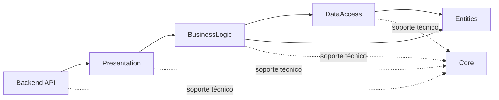
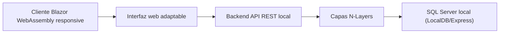

# Architecture Spine — Changa Quest

## Design Paradigm

Aplicación monolítica modular con API REST y capas N-Layers, conforme a la guía académica:

- **Presentation:** adaptador HTTP; endpoints, contratos HTTP y traducción a casos de uso.
- **BusinessLogic:** Managers y reglas/casos de uso del negocio.
- **DataAccess:** Stores, contratos de acceso a datos y persistencia con EF Core.
- **Entities:** modelos compartidos entre BusinessLogic y DataAccess; sin dependencias hacia capas superiores.
- **Core:** bibliotecas técnicas compartidas; soporte, no una capa ni autoridad de reglas de negocio.
- **Cliente web adaptable:** Blazor WebAssembly presenta la experiencia mobile-first y consume el contrato OpenAPI versionado de la API REST (`/api/v1`); la entrega de assets y el alojamiento quedan diferidos.
- **Backend API:** host y composition root; configura servicios, middleware y dependencias; no implementa reglas.

## Invariants & Rules

### AD-1 — Dependencias N-Layers

- **Binds:** toda la solución
- **Prevents:** ciclos y acceso a responsabilidades de capas superiores desde capas inferiores.
- **Rule:** las referencias permitidas son `Backend API → Presentation → BusinessLogic → DataAccess → Entities`, con `BusinessLogic → Entities`. El host obtiene el registro de dependencias mediante Presentation; cada capa registra sus propias dependencias hacia abajo. Una validación automática en la suite o en CI verifica las referencias permitidas; el mecanismo específico se elige al crear la solución. Las capas pueden usar bibliotecas técnicas específicas de `Core`; `Core` y `Entities` no referencian proyectos de capas. No se permiten otras referencias entre capas.



### AD-2 — SDD como fuente de intención; TDD como ciclo de implementación

- **Binds:** todo cambio funcional
- **Prevents:** que el comportamiento se decida únicamente en el código o que pruebas e implementación diverjan de lo acordado.
- **Rule:** cada cambio parte de una especificación versionada con criterios de aceptación vinculados a los FR del PRD. Antes de implementar, se escriben pruebas derivadas de esos criterios y se registra que el comportamiento nuevo falla (**Red**); se implementa lo mínimo para hacerlas pasar (**Green**) y luego se refactoriza conservando la suite (**Refactor**). Si especificación y prueba discrepan, se resuelve y actualiza primero la especificación y sus pruebas; el código no redefine el requisito. La suite completa debe pasar antes de aceptar el cambio.

### AD-3 — Propiedad de reglas y mutaciones

- **Binds:** publicación, postulaciones/asignación, consentimiento, finalización, pago declarado, cierre, cancelación, calificación y revisión administrativa.
- **Prevents:** controladores o persistencia imponiendo reglas propias, dos Managers compitiendo por el ciclo de vida de una changa y transiciones incompatibles entre recorridos.
- **Rule:** BusinessLogic es la única capa que decide y coordina reglas y transiciones. Un `ChangaManager` es dueño de las mutaciones del ciclo de vida de la changa y su asignación; otros Managers deben solicitarle esas transiciones, incluso para cancelaciones y decisiones administrativas. Sus transiciones se derivan del ciclo de vida especificado. Presentation valida el contrato HTTP y delega; DataAccess ejecuta las operaciones solicitadas por los Managers y no decide resultados de negocio. El `DbContext` y las consultas EF Core permanecen en DataAccess. La API registra dependencias mediante Presentation y no contiene casos de uso. El pago externo solo se registra como declaraciones separadas; la plataforma no lo procesa, custodia ni verifica.

### AD-4 — Asignación única aun con concurrencia

- **Binds:** FR-7..FR-15, para transiciones incompatibles sobre una misma changa.
- **Prevents:** asignaciones duplicadas, resultados parciales de selección y sobrescritura de transiciones incompatibles por concurrencia o reintentos.
- **Rule:** toda transición de ciclo de vida incompatible que compita sobre una misma changa se valida contra su estado persistido y se confirma atómicamente bajo la autoridad de `ChangaManager`. La toma o selección garantiza como máximo una asignación activa por changa. En modalidad de selección, la asignación, el resultado de la postulación elegida y el cierre de las demás postulaciones se confirman en una misma transacción de persistencia: se guardan todos esos cambios o ninguno. Repetir la toma ya confirmada por la misma persona devuelve la asignación existente; una persona distinta recibe HTTP 409 con el código estable `changa_already_assigned`, conforme a AD-6. DataAccess aplica las garantías de persistencia; BusinessLogic comunica el resultado. Las notificaciones se emiten después del commit; su mecanismo durable queda diferido. Pruebas de integración contra el proveedor elegido verifican toma concurrente, reintentos y transiciones que compiten.

### AD-5 — Ubicación exacta protegida por consulta y contrato

- **Binds:** FR-5, FR-6 y FR-9
- **Prevents:** exposición accidental de direcciones exactas en listados, detalles públicos o respuestas HTTP genéricas.
- **Rule:** BusinessLogic decide la proyección pública o autorizada; DataAccess entrega los datos solicitados y Presentation solo serializa el resultado permitido. Listados y detalles públicos devuelven zona aproximada y distancia, nunca dirección exacta. Una dirección exacta se devuelve solo en una operación autorizada para la persona asignada. Un teléfono se devuelve solo después de asignar y si ambas partes dieron consentimiento explícito. Estas condiciones se comprueban en cada consulta que expone datos sensibles, no solo en la interfaz. Pruebas de aceptación cubren acceso permitido y denegado.

### AD-6 — Contrato uniforme de errores HTTP

- **Binds:** todas las rutas públicas de la API REST.
- **Prevents:** clientes que deban interpretar formatos de error incompatibles entre endpoints.
- **Rule:** los errores HTTP usan `application/problem+json` conforme a Problem Details. Las respuestas distinguen errores de validación/regla de errores técnicos y mantienen un código estable cuando el cliente necesite actuar según el tipo de error; el conflicto de changa ya asignada usa HTTP 409 y el código `changa_already_assigned`. No se devuelve información interna sensible.

### AD-7 — Contrato canónico API-cliente

- **Binds:** todas las rutas REST y su consumo desde Blazor WebAssembly.
- **Prevents:** que API y cliente acuerden de forma independiente nombres de campos, nulabilidad, valores de enum o formas de respuesta incompatibles.
- **Rule:** la API se publica bajo `/api/v1` y un documento OpenAPI versionado es el contrato canónico de requests, responses, DTOs, nulabilidad, enums y errores. Las pruebas de contrato verifican las respuestas de la API contra el esquema y la compatibilidad del cliente Blazor con ese mismo contrato. Los cambios incompatibles requieren una nueva versión de API; los endpoints y campos concretos se derivan de las historias y se especifican antes de construir API y cliente de forma independiente.

## Consistency Conventions

| Concern | Convention |
| --- | --- |
| Nombres | Proyectos y namespaces con prefijo `ChangaQuest`; interfaces, Managers y Stores se nombran según la responsabilidad de su capa. Los nombres definitivos siguen la convención del repositorio al inicializarse. |
| Especificación y pruebas | Cada escenario de aceptación referencia FR y se expresa en Given/When/Then o forma equivalente verificable. Las pruebas se ubican por responsabilidad: reglas/casos de uso, integración de DataAccess y aceptación HTTP. |
| Estado y errores | Las transiciones se invocan como casos de uso de BusinessLogic; fallos de validación/regla se distinguen de errores técnicos y se traducen a Problem Details por Presentation, conforme a AD-6. |
| Contrato API-cliente | La versión `/api/v1` y su esquema OpenAPI son la referencia única de los DTOs HTTP; pruebas de contrato verifican API y cliente, conforme a AD-7. |
| Persistencia | EF Core, `DbContext`, migraciones y consultas viven en DataAccess. No se filtran tipos EF o `DbContext` a Presentation. |
| Privacidad | Dirección exacta y teléfonos no se devuelven antes de las condiciones de asignación y consentimiento definidas por el PRD. El GPS puntual no se persiste ni se reutiliza para seguimiento. |
| Calidad | La suite completa debe pasar antes de aceptar un cambio. Las pruebas de integración usan el proveedor real elegido para la aplicación; un doble InMemory no sustituye pruebas de persistencia o concurrencia. |

## Stack

| Name | Version |
| --- | --- |
| .NET SDK | 10.0.402 |
| .NET runtime | 10.0.13 LTS |
| ASP.NET Core Web API | 10.0.13 |
| Entity Framework Core | 10.0.13 LTS; compatible con .NET 10 |
| EF Core SQL Server provider | 10.0.13 |
| Blazor WebAssembly | ASP.NET Core 10.0.13 |
| xUnit.net (`xunit.v3`) | 4.0.2 (xUnit v3; compatible con .NET 8 o posterior) |

La cátedra confirmó que .NET 10 está permitido. Las versiones del stack se verificaron contra fuentes oficiales al 2026-10-20.

## Structural Seed

La demostración académica se ejecuta localmente con datos ficticios y no habilita tareas, ubicaciones, contactos ni pagos reales. El producto real no puede habilitar operaciones hasta resolver las condiciones legales, de confianza, seguridad y operación del PRD.



```text
/
  specs/                         # Especificaciones versionadas y criterios de aceptación
  src/
    backend/ChangaQuest.Api/     # Host, endpoints de arranque y composition root
    client/ChangaQuest.Client/   # Cliente Blazor WebAssembly; consume API REST
    layers/
      ChangaQuest.Presentation/  # HTTP y DTOs
      ChangaQuest.BusinessLogic/ # Managers y reglas/casos de uso
      ChangaQuest.DataAccess/    # Stores, EF Core y persistencia
      ChangaQuest.Entities/      # Modelos compartidos
    core/                        # Bibliotecas técnicas compartidas; no reglas de negocio
  tests/
    ChangaQuest.UnitTests/       # xUnit: reglas y casos de uso de BusinessLogic
    ChangaQuest.IntegrationTests/# EF Core, persistencia e integridad
    ChangaQuest.AcceptanceTests/ # Criterios funcionales a través de HTTP
```

## Capability → Architecture Map

| Capability | FR | Lives in / governed by | Alcance de demo académica |
| --- | --- | --- | --- |
| CAP-1 Publicar una changa segura | FR-1..FR-4 | Presentation, BusinessLogic, DataAccess, Entities; AD-1, AD-2, AD-3, AD-4, AD-7 | Incluida con cuentas verificadas, declaración de mayoría de edad y datos ficticios. |
| CAP-2 Encontrar changas y proteger ubicación | FR-5..FR-6 | Presentation, BusinessLogic, DataAccess; AD-1, AD-2, AD-3, AD-5, AD-7 | Incluida con ubicación manual y coordenadas ficticias; sin GPS ni mapas. |
| CAP-3 Asignar y consentir contacto | FR-7..FR-9 | Presentation, BusinessLogic, DataAccess; AD-1, AD-2, AD-3, AD-4, AD-5, AD-7 | Incluida con asignación por orden de llegada y consentimiento mutuo; selección entre postulaciones excluida. |
| CAP-4 Completar, cancelar y declarar pago | FR-10..FR-13 | Presentation, BusinessLogic, DataAccess; AD-1, AD-2, AD-3, AD-4, AD-6, AD-7 | Incluye finalización normal, cancelación antes de asignar y declaraciones de pago; sin cierre ni reasignación administrativa. |
| CAP-5 Calificarse mutuamente | FR-10..FR-13 | Presentation, BusinessLogic, DataAccess; AD-1, AD-2, AD-3, AD-7 | Incluida tras la finalización normal; el cierre administrativo queda excluido. |
| CAP-6 Reportar, bloquear y revisar | FR-14..FR-15 | Presentation, BusinessLogic, DataAccess; AD-1, AD-2, AD-3, AD-6, AD-7 | Excluida de la demo; permanece como capacidad del producto objetivo. |

## Deferred

- La demo usa EF Core SQL Server 10.0.13 con SQL Server LocalDB/Express local; verificar la instancia disponible y su compatibilidad en el entorno de ejecución al inicializar la solución. El proveedor y motor para el producto real siguen abiertos.
- Estructura exacta de entidades, claves, restricciones, endpoints, DTOs y límites entre Managers/Stores; se derivan de las historias y pruebas. Los DTOs HTTP deben quedar definidos en el contrato OpenAPI versionado antes de implementar API y cliente en paralelo.
- El paquete NuGet `xunit.v3` 4.0.2 gobierna las pruebas; fijar la configuración de runner, el host HTTP de aceptación y el pipeline CI al inicializar la solución.
- Blazor WebAssembly consume la API REST; la entrega de assets y su alojamiento local se resuelven al inicializar la solución sin cambiar esa frontera.
- Autenticación/verificación de identidad y autorización de producción; el PRD mantiene controles de confianza abiertos.
- Hosting, configuración por entorno, secretos, backups, monitoreo, disponibilidad y soporte operativo; definir antes de un piloto real.
- Requisitos legales y operativos que condicionan lanzamiento real; la arquitectura no constituye autorización para habilitar tareas reales.
- Datos ficticios, catálogo acotado y exclusión de reportes/bloqueos/revisión administrativa de la demo académica; confirmar sus límites antes de implementarla.
